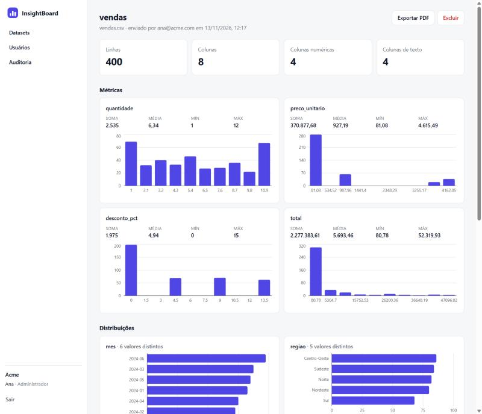
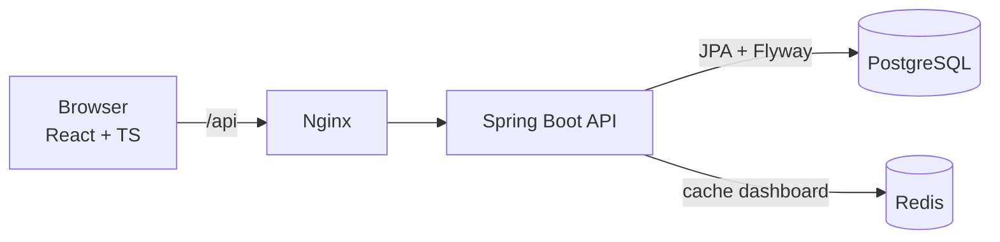

# InsightBoard

Plataforma de analytics **SaaS multi-tenant**: cada empresa cria seu espaço, envia arquivos CSV e recebe um dashboard com métricas e gráficos gerados automaticamente, com controle de acesso por papel, trilha de auditoria e exportação em PDF.

> Projeto de portfólio. O foco é mostrar decisões reais de backend (segurança, isolamento de dados, cache, migrations, testes), e não só telas bonitas.



## Funcionalidades

| | |
|---|---|
| **Login JWT** | Cadastro self-service (cria a empresa + primeiro admin), login, token com tenant e papel nos claims |
| **Multi-tenant** | Schema compartilhado com `tenant_id`; o tenant vem **sempre do token**, nunca do request |
| **Permissões** | `ADMIN` (tudo), `ANALYST` (envia CSV, exporta PDF), `VIEWER` (só visualiza) via `@PreAuthorize` |
| **Upload de CSV** | Detecta delimitador (`,` `;` tab), BOM do Excel, números em pt-BR (`1.234,56`) e en-US |
| **Dashboard + gráficos** | Tipos de coluna inferidos; soma/média/mín/máx + histograma por coluna numérica; top valores por coluna de texto |
| **Exportação PDF** | Relatório gerado no servidor (OpenPDF) |
| **Auditoria** | Quem fez o quê e quando (login, upload, exclusão, exportação, criação de usuário), por tenant |
| **APIs REST** | Documentadas com OpenAPI/Swagger em `/swagger-ui.html` |
| **Cache** | Dashboard cacheado no Redis por `(tenant, dataset)` |

## Stack

- **Backend:** Java 21, Spring Boot 3.5, Spring Security, Spring Data JPA, Flyway
- **Frontend:** React 18, TypeScript, Vite, Recharts
- **Dados:** PostgreSQL 16 (JSONB para linhas do CSV), Redis 7
- **Infra:** Docker, Docker Compose, GitHub Actions
- **Testes:** JUnit 5, AssertJ, MockMvc, Testcontainers

## Arquitetura



```
backend/src/main/java/com/insightboard
├── config/      SecurityConfig, OpenApiConfig
├── security/    JwtService, JwtAuthFilter, AuthUser (principal com tenantId e role)
├── domain/      entidades JPA (Tenant, User, Dataset, DatasetRow, AuditLog)
├── repository/  Spring Data (consultas sempre filtradas por tenant)
├── service/     regras: CsvParser, ColumnAnalyzer, DashboardService, PdfExportService...
└── web/         controllers REST, DTOs, tratamento global de erros
```

## Como rodar

Só precisa de **Docker**:

```bash
docker compose up --build
```

- App: http://localhost:3000
- API / Swagger: http://localhost:8080/swagger-ui.html

Depois: crie uma conta ("Cadastre sua empresa"), envie [`samples/vendas.csv`](samples/vendas.csv) (400 linhas, formato pt-BR com `;` e vírgula decimal) e explore o dashboard. Em **Usuários** você cria um `VIEWER` e vê as permissões em ação.

Para produção, copie `.env.example` para `.env` e defina `JWT_SECRET` e `DB_PASSWORD`.

### Desenvolvimento local

```bash
docker compose -f docker-compose.yml -f docker-compose.dev.yml up -d postgres redis   # só a infra, com portas expostas
cd backend && mvn spring-boot:run       # Java 21 + Maven
cd frontend && npm install && npm run dev   # http://localhost:5173 (proxy para :8080)
```

### Testes

```bash
cd backend && mvn verify
```

Inclui testes unitários (parser de CSV, números pt-BR/en-US, JWT) e um teste de integração com PostgreSQL real (Testcontainers, exige Docker) que prova que **um tenant não enxerga dados de outro** (404 em todos os recursos) e que cada papel só acessa o que deve.

## API

| Método | Rota | Papel |
|---|---|---|
| POST | `/api/auth/register` · `/api/auth/login` | público |
| GET | `/api/auth/me` | autenticado |
| GET | `/api/datasets` · `/{id}` · `/{id}/rows` · `/{id}/dashboard` | qualquer papel |
| POST | `/api/datasets` (multipart `file`) | ADMIN, ANALYST |
| GET | `/api/datasets/{id}/export/pdf` | ADMIN, ANALYST |
| DELETE | `/api/datasets/{id}` | ADMIN |
| GET · POST | `/api/users` | ADMIN |
| GET | `/api/audit` | ADMIN |

## Decisões e trade-offs

- **Multi-tenancy por coluna (`tenant_id`)** em vez de schema ou banco por tenant: simples de operar e suficiente para este porte. O custo é depender de disciplina nas consultas, por isso todo acesso a dataset passa por `findByIdAndTenantId` e há teste de integração cobrindo o vazamento. Evolução natural: Row Level Security do PostgreSQL como segunda barreira.
- **404 em vez de 403** quando o recurso é de outro tenant, para não revelar que ele existe.
- **Linhas do CSV em JSONB**: CSVs têm colunas arbitrárias, então um schema fixo não serve. Evita DDL dinâmico, ao custo de agregações menos eficientes.
- **Agregações em memória (Java)**: o dashboard carrega as linhas do dataset (limite de 50 mil linhas / 10 MB por upload). Por isso o resultado é cacheado no Redis. Evolução: empurrar as agregações para SQL sobre o JSONB.
- **JWT stateless de 2h, guardado em `localStorage`**: simples e comum em SPAs, mas vulnerável a XSS. Em produção eu migraria para cookie `HttpOnly` + refresh token.
- **Cadastro self-service cria um tenant novo**; usuários extras só entram por convite de um ADMIN (o tenant do novo usuário vem do admin que o criou).
- **Migrations com Flyway** e `ddl-auto=validate`: o schema é versionado e o Hibernate apenas confere.

## Roadmap

- [ ] Row Level Security no PostgreSQL
- [ ] Refresh token + cookie HttpOnly
- [ ] Agregações em SQL e upload assíncrono para arquivos grandes
- [ ] Detecção de colunas de data e gráficos de série temporal
- [ ] Rate limiting no login
- [ ] Deploy (AWS ECS Fargate + RDS + ElastiCache, ou GCP Cloud Run + Cloud SQL + Memorystore) com Terraform

## Licença

MIT
